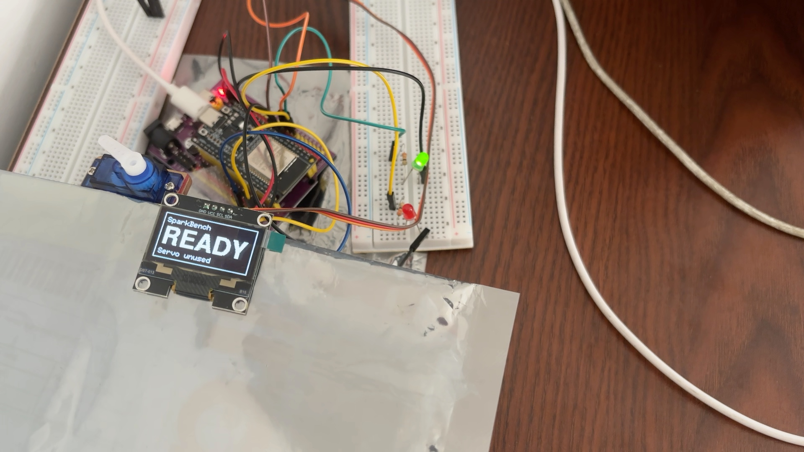
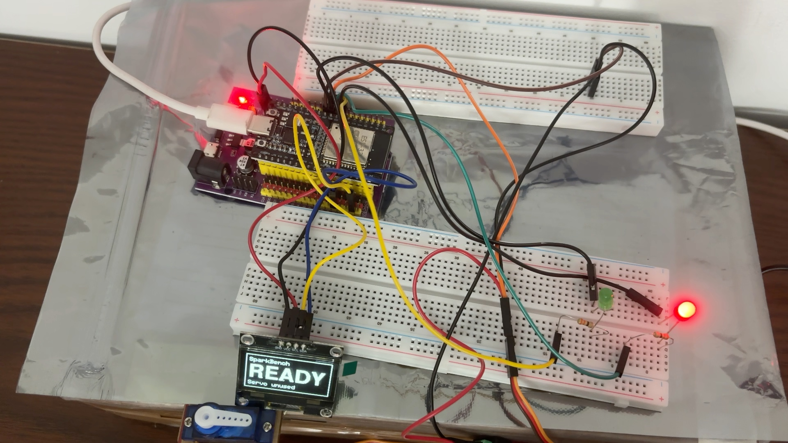
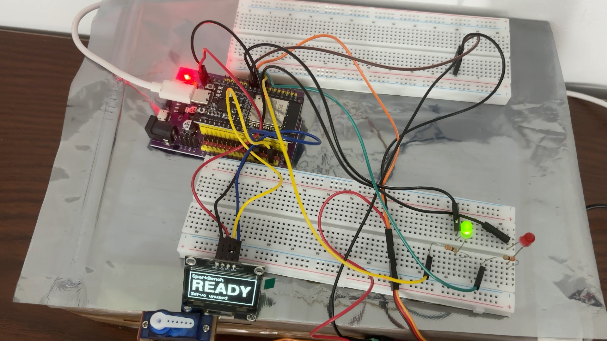

# SparkBench

**Proof beyond the build.** Describe what an ESP32 should do, review the plan Muse Spark proposes,
and approve a bench run. Trusted local code builds and installs the application. A fixed iPhone
camera records the LEDs and OLED while the plan runs. SparkBench compares the measured behavior
with the approved plan.

Built for **Push the Frontier** at the Meta Global AI Developer Hackathon, 26 October to
4 November 2026. SparkBench was built during the event with development assistance from Codex
and Claude Code. [Event page](https://cerebralvalley.ai/e/meta-ai-developer-hackathon) ·
[Demo video](https://youtu.be/y6KSh-sNYX0) · [Engineering log](docs/history.md)

## Built during the hackathon

Everything in this repository was built during the event's building period, 27 October to
4 November 2026: the dashboard and bench agent, the Muse Spark, SAM 3.1 and Muse Voice integrations,
the ESP32 LED/OLED runtime, the camera verifier and the mapping repair workflow. It was built with
development assistance from Codex and Claude Code. The dependencies are listed below under
[License](#license). The [demo video](https://youtu.be/y6KSh-sNYX0) shows only this work, and the
[demo video guide](docs/demo.md) names the recording each part comes from.

This git history begins on 3 November, when the project moved into this repository. The work before
that is recorded in the dated [engineering log](docs/history.md) and the
[handover notes](docs/archive/HANDOVER.txt), and the [evidence bundle](docs/evidence/README.md)
dates each recorded run.

## Recorded results



| Recording | Result |
| --- | --- |
| **Live wire swap and approved mapping repair**, 4 November | 38 mismatched readings across 28 samples, then a pass with 27 samples, zero mismatches and zero unknowns, with the wires still swapped. |
| **READY/BUSY/DONE**, 4 November | 26 sampled observations passed, with zero mismatches and zero unknowns. |
| **Independent LED + OLED check**, 3 November | An earlier plan passed 45 sampled observations, with zero mismatches and zero unknowns. |
| **Intentional LED wiring swap**, 3 November | 36 wrong-channel findings across 47 samples in a separate LED test. |
| **Incomplete OLED analysis**, 3 November | 45 of 48 OLED readings were unknown. The result remained incomplete. |
| **Evidence explanation** | Muse Spark explained a separate incomplete capture using saved findings and cited frames, then proposed a next check. |

| Fault test: READY lights red | After approved repair: READY lights green |
| --- | --- |
|  |  |

The [recorded evidence bundle](docs/evidence/README.md) includes selected camera frames, source
records and integrity hashes. The [demo video guide](docs/demo.md) lists what each part of the video
shows and which recording it comes from. [Watch the demo video](https://youtu.be/y6KSh-sNYX0), 2 minutes 56 seconds.

## How it works

1. Enter a behavior such as “Show READY with green on, BUSY with red on, then DONE with both
   off. Hold each for three seconds.” Muse Spark drafts a brief and a plan of up to eight steps.
2. Review the steps and choose **Approve plan and run on the bench**. This starts the workflow
   that checks devices and framing, builds and installs the application when needed, checks
   firmware identity and records the test. Separate controls are available for individual jobs.
3. Open the result to inspect the expected and observed LED states and OLED text. Each result
   is **pass**, **mismatch** or **incomplete**.
4. A confirmed LED mismatch can trigger one fixed GPIO25/26 probe. Muse Spark proposes a
   mapping from the camera measurements, and local code checks it. Review the exact mapping
   diff before approving compilation, installation and a retest against the unchanged behavior.
   Other non-pass results retain the advisory explanation flow. The complete sequence ran on
   real hardware on 4 November.

[Bounded mapping repair, evidence rules and live validation status](docs/mapping-repair.md)

A new plan starts with [camera setup](docs/camera-setup.md). The agent finds the parts in a fresh
frame, SAM 3.1 outlines them, and a separate capture validates the reference. It asks for edits
only if it cannot qualify the reference, and it sets the camera up again if the view changes.
Existing measurement thresholds remain frozen. One local automatic setup-to-test
session on 4 November passed 27 sampled observations, with zero mismatches and
zero unknowns. See the [setup records](docs/camera-setup.md#recorded-live-session).

## Meta Model API

The runtime calls `muse-spark-1.3-contributor` and validates structured responses. Guided
camera setup also uses `sam-3.1` through the Meta API for region proposals, and spoken ideas use `muse-voice-transcribe-1.0`. Planning,
framing advice and diagnosis use separate bounded requests. A camera test can make multiple
OLED requests, each for one eligible crop.

| Role | Input and output |
| --- | --- |
| **Build guide** | An idea and a fixed parts catalog produce a brief, clarification or unsupported result. |
| **Idea suggester** | On request, three project ideas for this bench. Each carries steps that must pass the plan validator, and it only fills the idea box. |
| **Intent planner** | The instruction and capability contract produce a structured plan for review. The planner matched the independently written expectations in eight benchmark cases. |
| **OLED reader** | A single display crop produces a readable flag and text. The request omits the expected label. |
| **Frame checker** | A blocked camera view can produce placement advice for the operator. The local check decides whether the view is usable. |
| **SAM region proposer** | A fresh setup photo and selected lens points produce component regions for confirmation. A separate capture checks the resulting reference; SAM does not decide behavior pass/fail. |
| **Voice transcriber** (`muse-voice-transcribe-1.0`) | A spoken idea of up to 30 seconds becomes editable text in the idea box. The audio is never stored; the request record is. Nothing is planned until the person reviews the text. |
| **Evidence analyst** | The approved steps, measurements and up to three saved frames produce an advisory explanation, cited frames and one next check. Local code validates the citations. |
| **Mapping repair analyst** | The fixed probe's camera measurements and current firmware assumption produce a proposed GPIO25/26 mapping and cited evidence. Local inference must agree; installation requires approval. It ran on the real board on 4 November with a disclosed wire swap. |

The model proposes bounded data. Local code validates the pin and step limits, renders a C++
data table for the trusted runtime and runs the bench. The verifier measures LED pixels and
compares those observations and the model's OLED readings with the frozen plan. Verdicts cover
sampled settled windows in the calibrated view. Unreadable observations remain unknown.

[Architecture diagram](docs/images/architecture.svg) · [Dashboard guide](docs/dashboard.md) ·
[Software pipeline](docs/software-pipeline.md)

## Hardware

| Part | Detail |
| --- | --- |
| Board | Classic ESP32 (ESP32-D0WD-V3, 4 MB flash, 38-pin carrier, CP2102 USB-C) |
| Outputs | Red LED on GPIO25, green LED on GPIO26, each through a 330 Ω resistor |
| Display | 128 × 64 I²C OLED at 0x3C on SDA 21 / SCL 22 (SH1106 profile) |
| Camera | iPhone 15 through macOS Continuity Camera, fixed stand |
| Host | macOS, Python 3.11, PlatformIO, esptool and a Swift capture helper |

The submission covers the LED/OLED runtime. The mounted servo's angle calibration and full-rig
acceptance are future work. [Wiring diagrams](hardware/diagrams) ·
[Full-rig acceptance plan](docs/full-rig.md)

## Run it

For a source-only dashboard preview, run the following from the repository root and open
[localhost:8765](http://127.0.0.1:8765/). Browsing the interface uses no API key.

```bash
PYTHONPATH=src python3 -m sparkbench dashboard
```

The source checkout omits the local `runs/` archive. The Evidence tab lists built-in examples as
unavailable until their complete run records are present. Open the selected recorded results in
the [evidence bundle](docs/evidence/README.md).

For live work on macOS, run `tools/bootstrap_macos.sh` to create the environment, install the
tools, run host tests and print the readiness report. Then configure `META_API_KEY` in the local
`.env` and start with `.venv/bin/python -m sparkbench dashboard`. Live testing needs a commissioned
bench, including a verified prior application and boot-layout records for installation and a
frozen camera calibration for verification. [Commissioning details](docs/commissioning.md)

The final 4 November update passed all 372 host tests.
Run the suite from the repository root.

```bash
PYTHONPATH=src .venv/bin/python -m unittest discover -s tests -v
```

## License

SparkBench is released under the [MIT License](LICENSE). PlatformIO, the Espressif Arduino framework
and U8g2 are fetched at build time, and the dashboard loads the Fraunces and Inter fonts from Google
Fonts. These remain under their own licenses.

## Repository layout

| Path | Contents |
| --- | --- |
| `src/sparkbench/` | CLI, Meta clients, verifier, build and install, camera and servo tooling |
| `src/sparkbench/dashboard/` | Loopback HTTP server, project and job state, static UI |
| `firmware/` | PlatformIO projects for the LED/OLED runtime and bring-up diagnostics |
| `tests/` | Host tests and native C++ and Swift simulation tests |
| `tools/` | macOS camera, vision and tracker helpers, bootstrap and packaging scripts |
| `hardware/` | Board, camera and calibration records, wiring diagrams |
| `docs/` | Evidence, guides, submission script and dated engineering log |
| `specs/`, `examples/` | Frozen behavior specifications and example plans |
