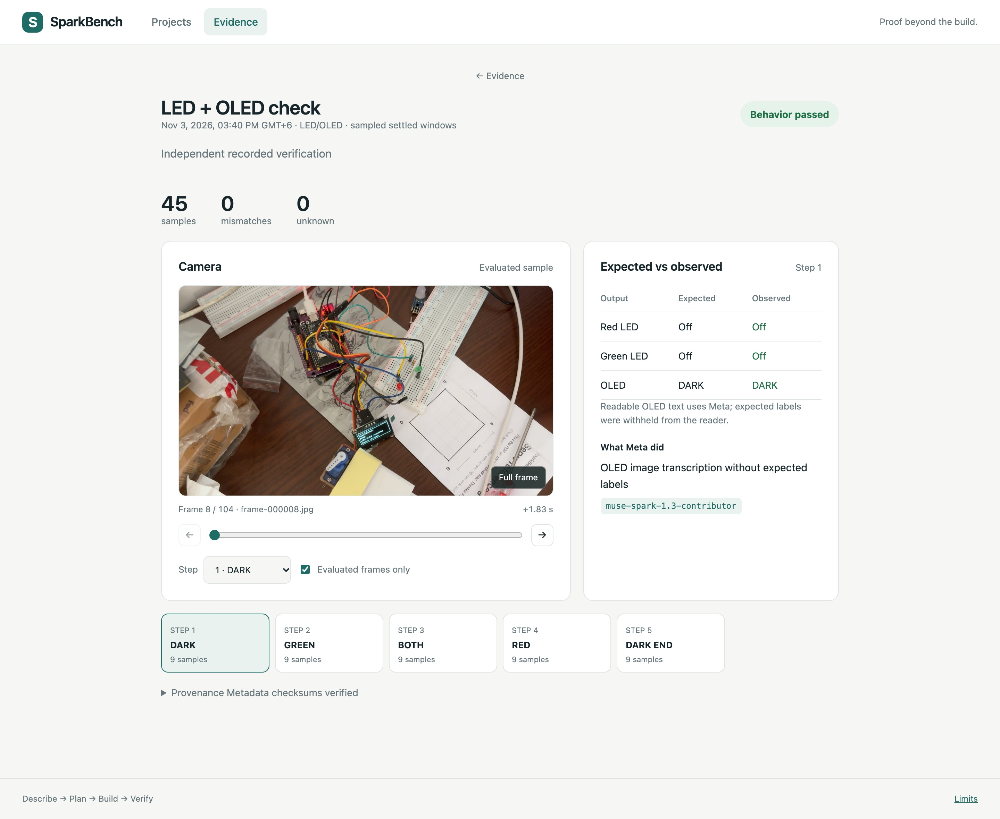
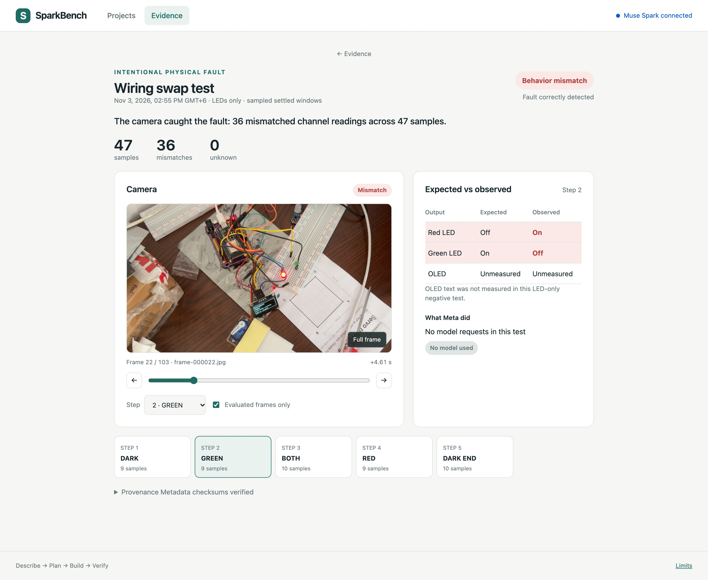
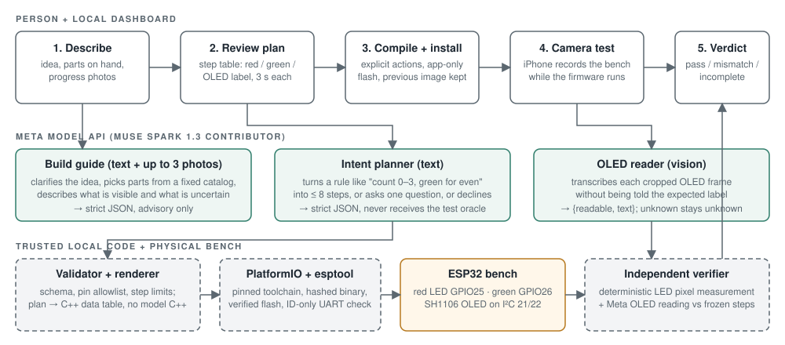
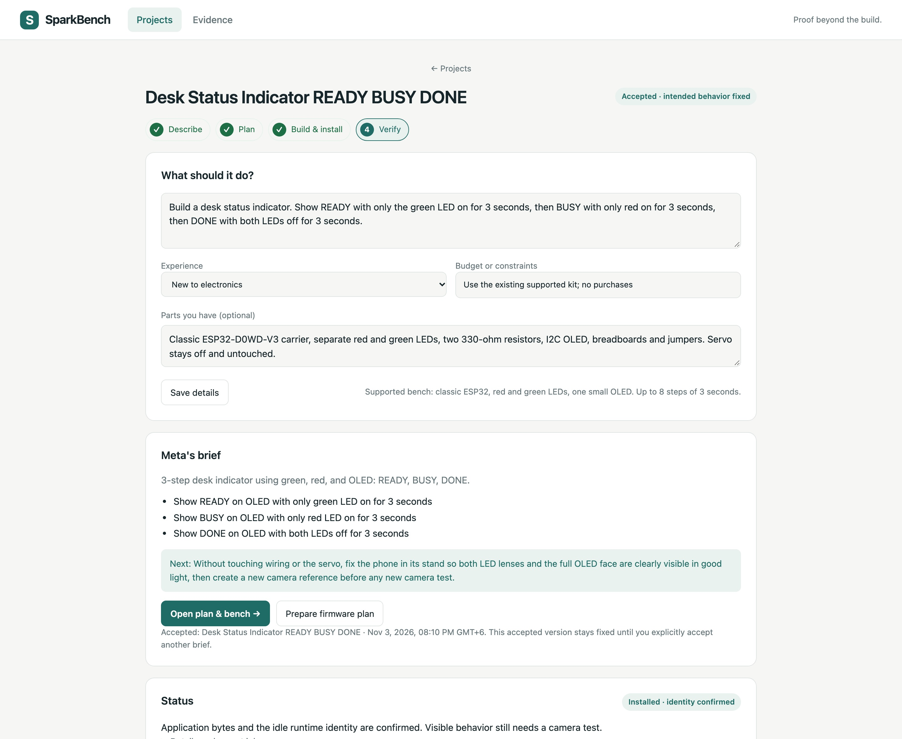
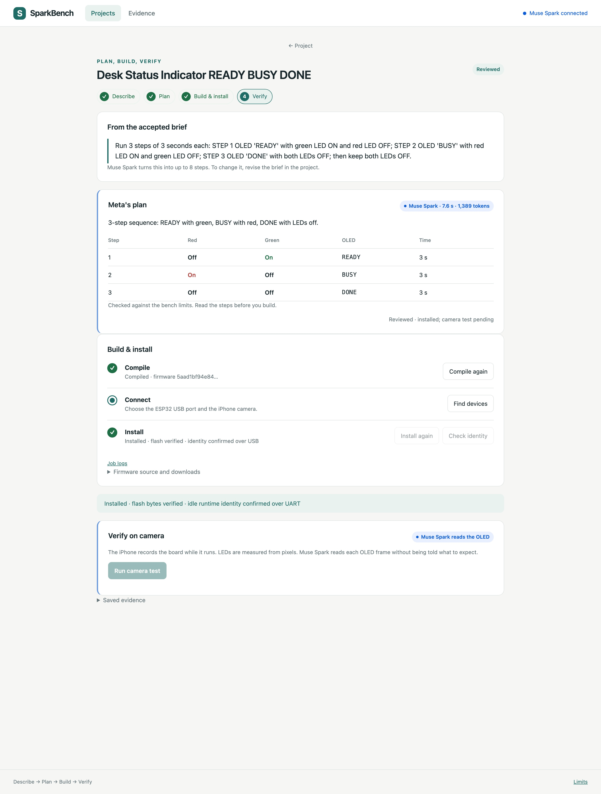
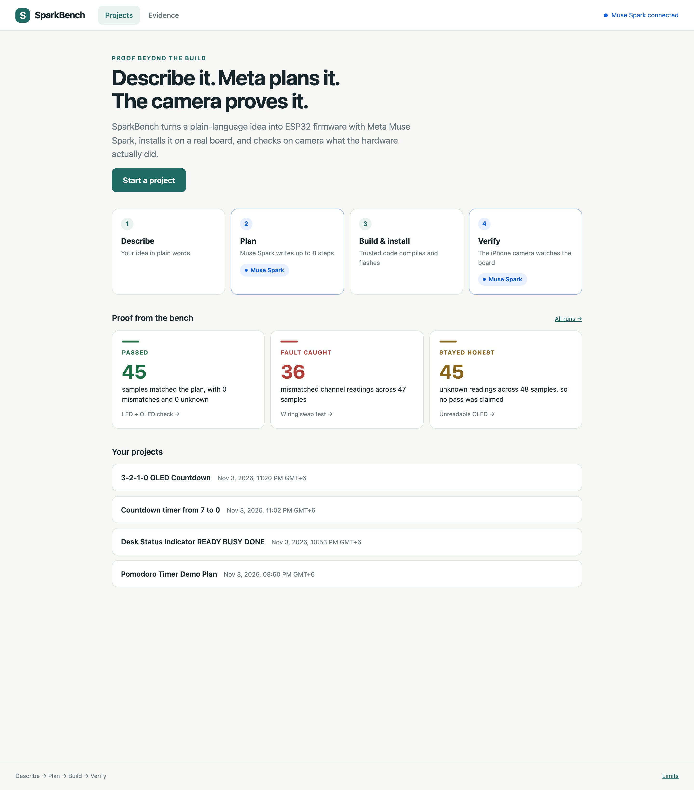

# SparkBench

**Proof beyond the build.** SparkBench turns a plain-language idea into ESP32 firmware with
Meta's Muse Spark, then points a camera at the board and independently checks what the hardware
actually did. A build that compiles and a UART "OK" are not proof. LEDs lighting in the right
order and the right text on the OLED, measured from video, are.

Built for the [Meta Global AI Developer Hackathon](https://cerebralvalley.ai/e/meta-ai-developer-hackathon)
(26 October – 4 November 2026), problem statement **Push the Frontier**: a better way to understand
and control a physical system.

**Everything in this repository was built during the hackathon**, from the first board bring-up on
27 October to the explanation feature on 3 November. The dated engineering log is
[docs/history.md](docs/history.md). Development was AI-assisted (Codex and Claude Code sessions
driven by the author). The runtime Meta model calls are exactly the ones listed under
[How Meta AI is used](#how-meta-ai-is-used), and every request is saved under `runs/`.



## The problem

AI coding agents can now write embedded firmware in seconds and report success. For a board on a
desk, "success" usually means the code compiled and the serial port printed `DONE`. Nobody checks
whether the red LED is actually red, whether the OLED says `READY` or `REAOY`, or whether two wires
are swapped. Beginners cannot tell the difference, and experienced engineers waste hours finding
out.

SparkBench closes that loop. The model plans, trusted local code builds and installs, a phone
camera records the bench, and a deterministic verifier compares the frames with the plan.
Failures and unknowns are kept, not hidden.

## What a judge can see in two minutes

| Beat | What happens | Evidence |
| --- | --- | --- |
| Describe | Type "Show READY in green, BUSY in red, then DONE with both off, 3 s each." into the box on the home page. Muse Spark clarifies the idea, picks parts from the supported kit and drafts the behavior; a panel shows the brief and then the step table. | Home page box and plan panel |
| Plan | Meta's intent planner returns up to 8 steps as strict JSON. Ambiguous requests get one question; unsupported hardware is refused, not approximated. | 8/8 frozen benchmark cases matched the independently written expectations |
| Approve and run | One click marks the plan reviewed and hands it to the agent, which compiles (a C++ data table rendered by trusted code), connects, flashes the application only, confirms identity over UART, and skips any step the saved records already prove. A live timeline shows each decision. | Hashes and logs per job; the timeline on the page |
| Verify | The iPhone records the board while the firmware runs. LED colours are measured from pixels; OLED text is read by Meta without being told the expected label. | 45 sampled observations, 0 mismatches, 0 unknowns |
| Catch a fault | With the two LED wires deliberately swapped, the verifier reports the wrong channel. | 36 wrong-channel findings in 47 samples |
| Explain | On a failed run, Muse Spark reads the expected steps, the measured findings and the key frames, names the likely cause, cites the frames it used and proposes one check. It cannot change the verdict. | Strict JSON reply; citations must be among the supplied frames or the reply is rejected |
| Stay honest | A badly framed capture is reported as *incomplete*, never as a pass. | 45 of 48 OLED readings unknown, result kept as incomplete |



Demo video: _link to be added before submission._ The recorded walkthrough script is in
[docs/demo.md](docs/demo.md).

## How Meta AI is used

All calls go to the Meta Model API with `muse-spark-1.3-contributor`, structured output through
JSON Schema, one bounded request per action, no retries, and every request, response, latency and
token count saved to disk with integrity hashes.

| Role | Input | Output | Deliberately withheld from the model |
| --- | --- | --- | --- |
| **Build guide** (text + up to 3 photos) | idea, experience, parts on hand, a fixed component catalog, the capability contract | decision (planned / clarify / unsupported), goals, parts list, what is visible and what is uncertain in the photos, one next step | any authority over pass or fail |
| **Intent planner** (text) | the instruction and the capability contract | ready steps, one clarification question, or unsupported | the expected answer and the test oracle |
| **OLED reader** (vision) | one cropped OLED frame | `{readable, text}` | the expected label |
| **Frame checker** (vision) | the calibrated view and the current camera frame, only when the camera check is blocked | which parts are cut off, one fix for the person | any power to clear the check or touch a verdict |
| **Evidence analyst** (vision + reasoning) | frozen expected steps, measured findings, up to three recorded frames | diagnosis, confidence, cited frames, one next check, what cannot be determined | the verifier's thresholds and pass logic; any power to change a verdict |
| **Behavior generator** (CLI) | a structured spec and a measured pin mapping | a bounded plan | pins, timing and code outside the contract |

Why this is more than a chat wrapper: the model proposes *data*, never code, and never grades
itself. Trusted local code enforces a pin allowlist, step limits and a fixed runtime, and an
independent verifier compares the physical result with the frozen plan. When the model cannot read
the display, the sample stays *unknown* rather than becoming a pass or a fail. When a run fails,
the model explains it from the recorded evidence, and the explanation is advisory.

## Architecture



- **Dashboard**: Python standard library HTTP server plus vanilla JavaScript, loopback only, with
  a per-session token and same-origin checks on every action. Browsing saved work never calls a
  model or touches hardware. Each hardware action (compile, install, camera test) is a separate
  explicit button.
- **Agent**: after one approval it runs those same jobs in order on a live timeline, skips what
  the saved records already prove, confirms every part is in frame and the OLED is readable before running, waits for you to fix it if not, reads a non-pass
  result with Muse Spark and decides the next step: check the wiring or stop on unknown readings. It never
  changes wiring, mappings or limits, and it stops wherever a person is needed.
- **Firmware**: a fixed runtime on a classic ESP32 reads a generated data table. Serial protocol
  is `ID`, `VISUAL`, `DISCOVER`, `PING`, `STOP` with lease timeouts, so a lost host connection
  turns outputs off. No servo or PWM code exists in the LED/OLED runtime.
- **Verifier**: deterministic LED pixel measurement in sampled settled windows plus Meta OLED
  transcription, compared against the frozen expected steps. Pass, mismatch and incomplete are
  separate outcomes.
- **Evidence**: every run keeps raw frames, UART timestamps, request and response records and
  SHA-256 manifests. The dashboard refuses to display evidence that fails its integrity check.





## Hardware

| Part | Detail |
| --- | --- |
| Board | Classic ESP32 (ESP32-D0WD-V3, 4 MB flash, 38-pin carrier, CP2102 USB-C) |
| Outputs | Red LED on GPIO25, green LED on GPIO26, each through a 330 Ω resistor |
| Display | 128 × 64 I²C OLED at 0x3C on SDA 21 / SCL 22 (SH1106 profile) |
| Camera | iPhone 15 through macOS Continuity Camera, fixed stand |
| Host | macOS, Python 3.11, PlatformIO, esptool, a small Swift capture helper |

Wiring references: [hardware/diagrams](hardware/diagrams), and the known-kit diagram inside the
dashboard. An SG90 servo is mounted on the rig but the current runtime never drives it.

## Run it

```bash
tools/bootstrap_macos.sh
```

That creates `.venv`, installs PlatformIO and esptool, runs the host tests and prints a readiness
report without touching hardware. Then add a Meta key:

```bash
printf 'META_API_KEY=your_key\nMETA_MODEL=muse-spark-1.3-contributor\n' > .env
```

```bash
.venv/bin/python -m sparkbench dashboard
```

Open http://127.0.0.1:8765. The dashboard is one linear flow: Projects → a project page (Describe) → Plan, build, verify → Evidence.



Guides: [dashboard](docs/dashboard.md),
[building a project](docs/build-guide.md), [intent planning](docs/intent-planning.md),
[software pipeline and trust boundary](docs/software-pipeline.md), [live validation](docs/live-validation.md).

Host tests (241, no hardware, no network):

```bash
.venv/bin/python -m unittest discover -s tests -v
```

Recorded evidence (about 7 GB of frames and logs under `runs/`) is not in this repository, so a
fresh clone shows the Projects page but an empty Evidence tab and no proof cards. The reports
quoted above are summarised in [docs/live-validation.md](docs/live-validation.md) and
[docs/demo.md](docs/demo.md).

## Honest limits

- One supported kit and a fixed contract: at most 8 steps of 3 s, two LEDs, 16-character labels.
  The model proposes data; it does not write arbitrary C++.
- Verdicts cover sampled settled windows in the recorded view, not continuous behavior or
  electrical measurements.
- The servo is unmeasured. Angle calibration and the full-rig A/B acceptance tests are future work.
- Photo guidance is advisory. A photo cannot establish continuity, voltage or polarity.
- The phone must stay still in its calibrated position. The agent checks this before flashing, and
  frames from any other position are rejected, never read or guessed.
- An OLED reading the model declines counts as unknown, so that plan ends incomplete rather than pass.

## Repository layout

| Path | Contents |
| --- | --- |
| `src/sparkbench/` | CLI, Meta clients (`meta.py`, `intent.py`, `guide.py`, `diagnosis.py`, `generation.py`), verifier, build and install, camera and servo tooling |
| `src/sparkbench/dashboard/` | local server, project and job state, static UI |
| `firmware/` | PlatformIO projects: the LED/OLED runtime and the bring-up diagnostics |
| `tests/` | 241 host tests plus native C++ and Swift simulation tests |
| `tools/` | macOS camera, vision and tracker helpers, bootstrap and packaging scripts |
| `hardware/` | board, camera and calibration records, wiring diagrams |
| `docs/` | guides, contest audit, and the full [project history](docs/history.md) |
| `specs/`, `examples/` | frozen behavior specifications and example plans |

The day-by-day engineering log from 27 October to 3 November, including every retained failure,
is in [docs/history.md](docs/history.md).
