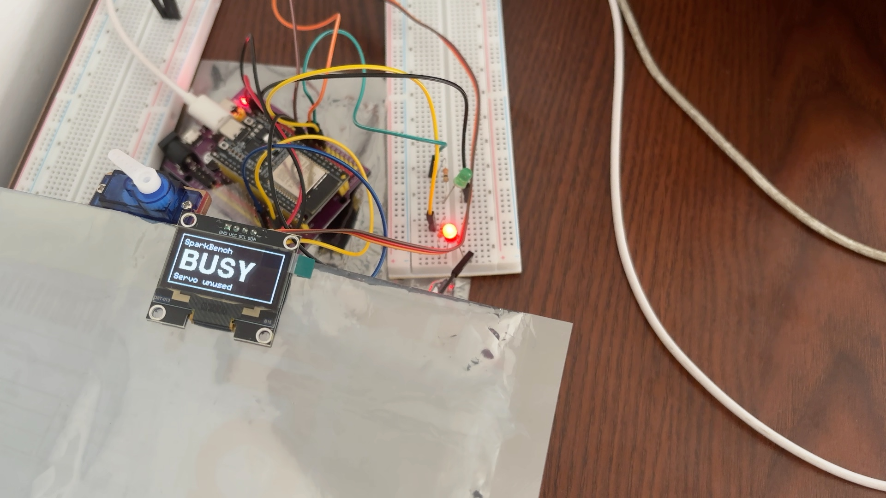
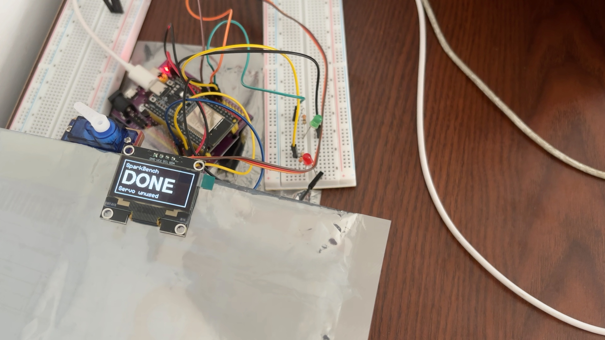
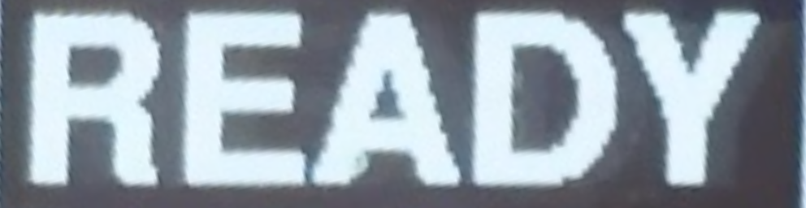
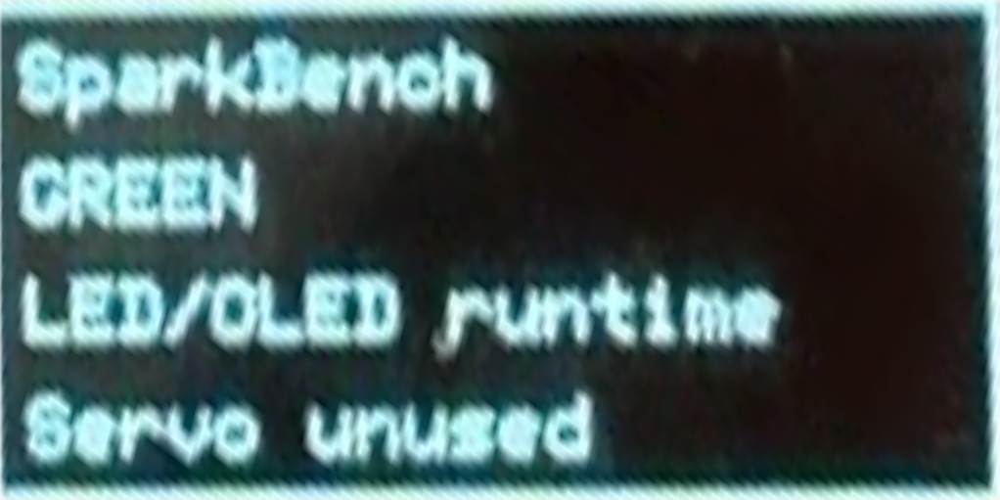
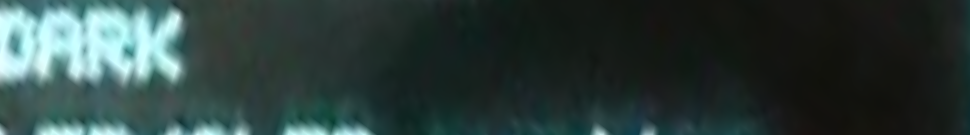

# SparkBench recorded evidence

These extracts can be reviewed directly in the repository. Each row comes from a separate saved record. The READY/BUSY/DONE sequence is the featured project. The wiring swap and the two incomplete tests show how the verifier handles different failure modes. The repair and re-test flow still needs a complete recorded hardware session.

| Recording | Automatic result | Scope |
| --- | --- | --- |
| READY/BUSY/DONE, 4 November 2026 | Pass, 26 sampled observations, 0 mismatches, 0 unknowns | Two external LEDs and OLED text |
| Intentional wiring swap, 3 November | Fault detected, 36 mismatched channel readings across 47 samples | Two external LEDs |
| Unreadable OLED crop, 3 November | Incomplete, 45 unknown OLED readings across 48 samples | Two external LEDs and OLED text |
| Camera view outside calibration, 3 November | Incomplete, 37 rejected samples and 111 unknown field readings | Two external LEDs and OLED text, with a separate advisory explanation |

## Featured project

The frozen plan expected green with READY, red with BUSY, and both external LEDs off with DONE. The verifier compared pixel measurements and OLED transcriptions with that plan in the settled portions of the three steps. The original JPEGs below are the first evaluated frame in each step.

| READY · green on · 7 samples | BUSY · red on · 9 samples | DONE · both off · 10 samples |
| --- | --- | --- |
|  |  |  |

Muse Spark received a cropped OLED image and a transcription prompt. The expected label stayed in the verifier. This saved model input came from frame 8, and the recorded reply was `{"readable":true,"text":"READY"}`.



[All 26 observations and firmware identity](hero.json) · [Model input and reply](hero-reader.json)

## Historical wiring swap

The operator deliberately swapped the two LED connections. In frame 22, the plan expected green on and red off. The pixel measurement found green off and red on. This frame contributed two wrong-channel readings. The qualification record marks the intentional fault as detected and the LED behavior comparison as failed.



The OLED crop shows the step label for context. The fault verdict came from the external LED measurements.

[All 47 observations and 36 channel mismatches](wiring-fault.json)

## Historical incomplete OLED run

The OLED reader received the clipped crop below for frame 8 and returned `{"readable":false,"text":null}`. Unreadable values counted as unknown, leaving the run incomplete.



[All 48 observations and 45 unknown readings](incomplete.json) · [Model input and reply](incomplete-reader.json)

## Advisory explanation and citation validation

This separate recorded countdown run had 37 evaluated samples rejected by the frozen camera geometry check. Each of the three fields was unknown in each sample. Muse Spark later received the two listed frames and the recorded findings, then suggested checking the camera reference. The accepted explanation cited frames 8 and 9 and left the verdict incomplete.

An earlier reply on the same recording put supplied frame names inside sentences. The validator at the time required bare filenames and rejected it. The current parser extracts supplied filenames from prose and rejects citations with no supplied filename. Both archived outcomes remain available below.

[Countdown measurements](diagnosed-run.json) · [Accepted explanation](diagnosis-accepted.json) · [Earlier rejected reply](diagnosis-rejected.json)

## Provenance

The bundle contains selected structured records and six images. Its original JPEGs and saved crops match the source bytes. The JSON extracts contain repository-relative source references and omit host-specific paths and API response identifiers. The archived diagnosis frame hashes refer to the original wide frames held locally.

The export checked the source reports, frozen plans, frame indexes, and all 158 evaluated frame hashes against the local capture records. It also verified the two diagnosis request and response records and the saved image hashes. A reviewer can check the integrity of the exported files with the commands below.

```sh
cd docs/evidence
shasum -a 256 -c SHA256SUMS
```

The checksums verify file contents. The observations cover sampled settled windows on the recorded bench, with servo movement outside the scope of these results.

[Source paths and recorded SHA-256 hashes](source-artifacts.json) · [Bundle checksums](SHA256SUMS)
